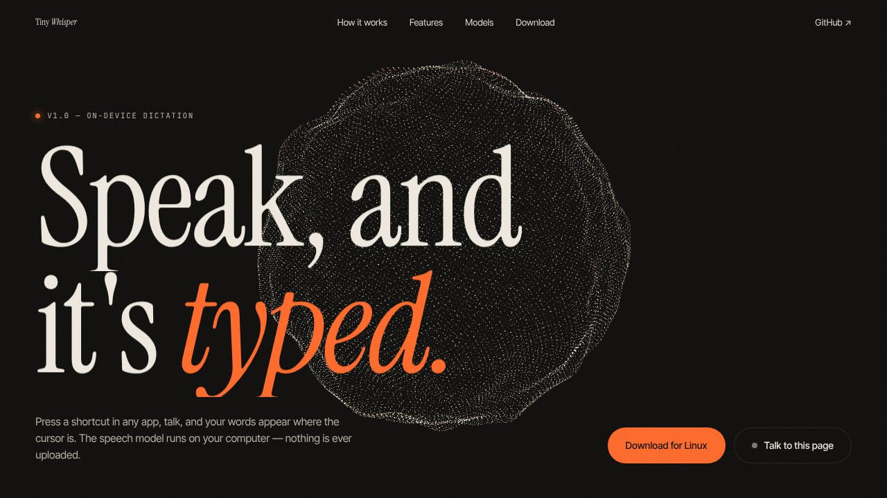
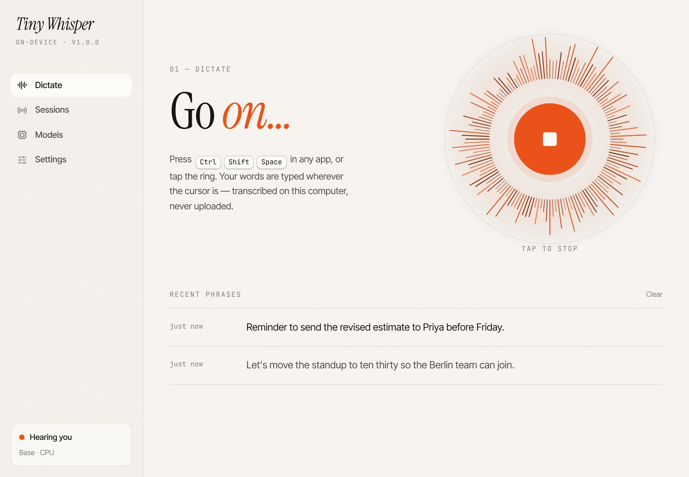
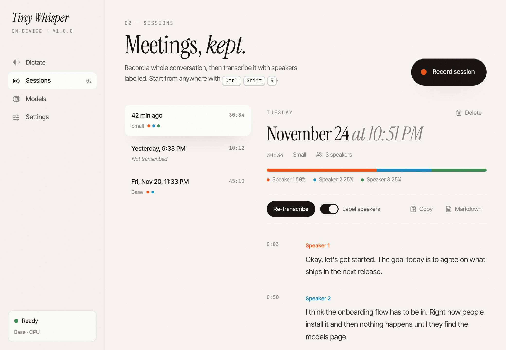
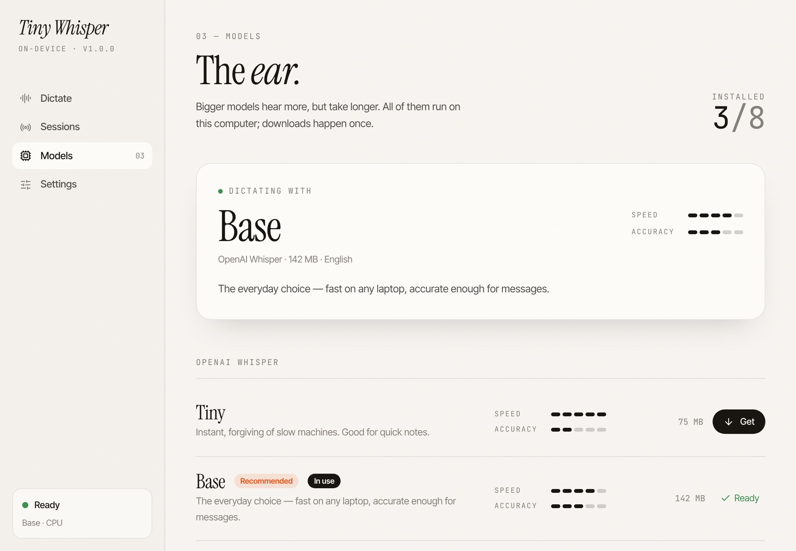
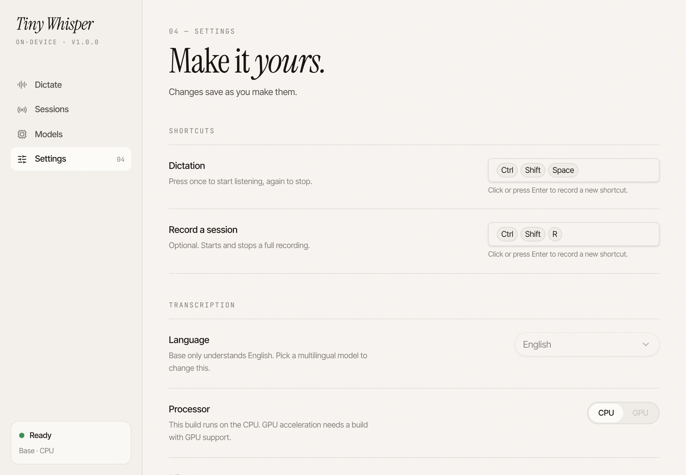
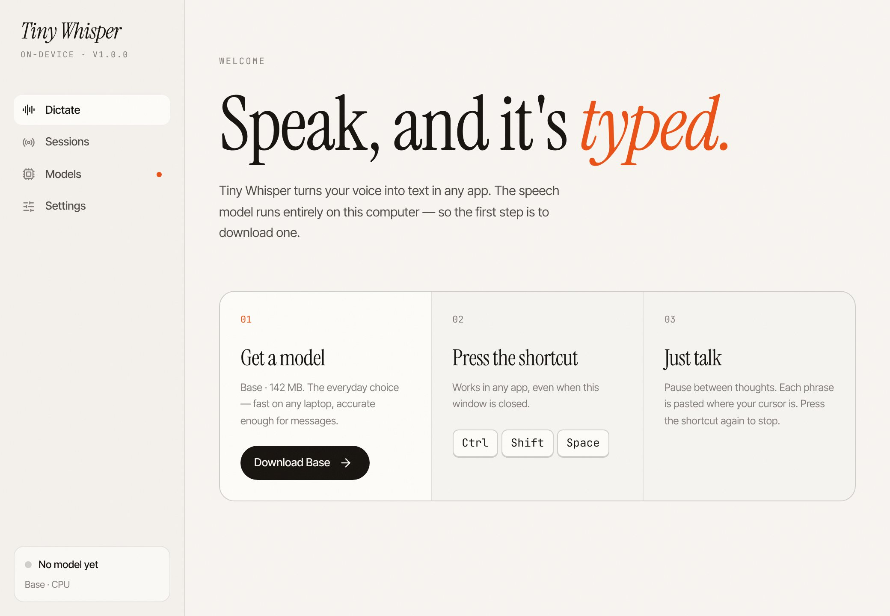
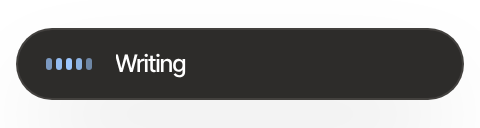
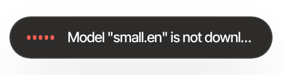

<div align="center">

<a href="https://sunderbharath85.github.io/tiny-whisper/"></a>

# Tiny Whisper

**Private, on-device dictation for macOS, Windows and Linux.**<br />
Press a shortcut in any app, talk, and your words appear where the cursor is.<br />
The speech model runs on your computer — nothing you say is ever uploaded.

[](https://github.com/sunderbharath85/tiny-whisper/actions/workflows/ci.yml)
[](https://github.com/sunderbharath85/tiny-whisper/actions/workflows/release.yml)
[](https://github.com/sunderbharath85/tiny-whisper/releases/latest)

[**Download**](https://github.com/sunderbharath85/tiny-whisper/releases/latest) ·
[Website](https://sunderbharath85.github.io/tiny-whisper/) ·
[Changelog](CHANGELOG.md) ·
[Build from source](#development)

</div>

---

## Contents

- [Highlights](#highlights)
- [Screenshots](#screenshots)
- [Install](#install)
- [Quick start](#quick-start)
- [Keyboard shortcuts](#keyboard-shortcuts)
- [Models](#models)
- [Privacy](#privacy)
- [Where your data lives](#where-your-data-lives)
- [Troubleshooting](#troubleshooting)
- [Development](#development)
- [Releasing](#releasing)
- [Website](#website)

## Highlights

- **Dictate into anything.** One global shortcut starts listening; every pause becomes a phrase that is pasted wherever your cursor is — chat, email, your editor, a browser form.
- **Nothing gets lost.** Each phrase is also kept in *Recent phrases*; if it went to the wrong window, one click copies it again.
- **Meetings, kept.** Record a whole conversation as a *session*, then transcribe it with every speaker labelled. Rename speakers, see who talked how much, copy as text or Markdown.
- **Choose your ear.** Eight local models — OpenAI Whisper from Tiny to Large v3, and NVIDIA Parakeet — compared by speed and accuracy, switchable any time.
- **Private by design.** Audio never leaves your computer. No account, no cloud, no subscription.
- **Quiet until you speak.** Lives in the tray / menu bar with a small floating indicator; light and dark themes follow your system.

## Screenshots

> Screenshots follow your GitHub theme — switch between light and dark to see both.

### Dictate
The ring reacts as you speak; the big button starts and stops dictation, and every phrase lands in *Recent phrases*.

<picture>
  <source media="(prefers-color-scheme: dark)" srcset="docs/screenshots/dictate-dark.jpg" />
  
</picture>

### Sessions
Recordings on the left, the transcript on the right — with each speaker's share of the conversation, editable speaker names, and *Copy* / *Markdown* export.

<picture>
  <source media="(prefers-color-scheme: dark)" srcset="docs/screenshots/sessions-dark.jpg" />
  
</picture>

### Models
Speed and accuracy at a glance, what's in use, what's recommended, and per-model download progress. The model in use can't be deleted by accident.

<picture>
  <source media="(prefers-color-scheme: dark)" srcset="docs/screenshots/models-dark.jpg" />
  
</picture>

### Settings
Changes save as you make them. Shortcuts are recorded by pressing them; language is locked for English-only models; GPU is offered only when your build supports it.

<picture>
  <source media="(prefers-color-scheme: dark)" srcset="docs/screenshots/settings-dark.jpg" />
  
</picture>

### First run
A fresh install walks you through downloading the recommended model, so you're dictating within a minute.

<picture>
  <source media="(prefers-color-scheme: dark)" srcset="docs/screenshots/welcome-dark.jpg" />
  
</picture>

### Floating indicator
A small always-on-top pill shows what Tiny Whisper is doing, even when the main window is closed.

| Listening | Hearing you | Writing | Recording a session | Error |
| :---: | :---: | :---: | :---: | :---: |
|  |  |  |  |  |

Errors stay on the pill for a few seconds; hover it to read the full message.

## Install

Download the installer for your system from the [latest release](https://github.com/sunderbharath85/tiny-whisper/releases/latest).

| System | File | Notes |
| --- | --- | --- |
| macOS — Apple Silicon | `.dmg` (aarch64) | Built with Metal GPU acceleration. |
| Windows 10 / 11 | `.msi` or `.exe` | |
| Linux x64 | `.AppImage` or `.deb` | Built on Ubuntu 24.04; needs glibc 2.38 or newer. |

**First launch**

- **macOS** — if the build isn't notarized, right-click the app → **Open** the first time. Allow **Microphone** access when asked, and add Tiny Whisper under **System Settings → Privacy & Security → Accessibility** so it can paste into other apps. Until then, transcribed text is left on the clipboard.
- **Windows** — an unsigned installer shows a SmartScreen warning: **More info → Run anyway**.
- **Linux** — for the AppImage, `chmod +x` it first. Pasting simulates keystrokes through X11 (`libxdo`), so it may not work in Wayland-only sessions.

## Quick start

1. **Get a model.** On first launch, click *Download Base* (142 MB) — the everyday choice. You can pick another in **Models** later.
2. **Press the shortcut** — <kbd>Ctrl</kbd> <kbd>Shift</kbd> <kbd>Space</kbd> (<kbd>⌘</kbd> <kbd>⇧</kbd> <kbd>Space</kbd> on macOS) — in any app.
3. **Talk.** Pause between thoughts; each phrase is pasted where your cursor is. Press the shortcut again to stop.

To record a meeting instead, press <kbd>Ctrl</kbd> <kbd>Shift</kbd> <kbd>R</kbd> (<kbd>⌘</kbd> <kbd>⇧</kbd> <kbd>R</kbd>) or click **Record session**, then open it in **Sessions** and click **Transcribe**. Turn on *Label speakers* (downloads the Sortformer model) to tell voices apart.

## Keyboard shortcuts

| Action | Default (Windows / Linux) | Default (macOS) |
| --- | --- | --- |
| Start / stop dictation | <kbd>Ctrl</kbd> <kbd>Shift</kbd> <kbd>Space</kbd> | <kbd>⌘</kbd> <kbd>⇧</kbd> <kbd>Space</kbd> |
| Start / stop a session recording | <kbd>Ctrl</kbd> <kbd>Shift</kbd> <kbd>R</kbd> | <kbd>⌘</kbd> <kbd>⇧</kbd> <kbd>R</kbd> |

Change them in **Settings → Shortcuts**: click the field and press the new combination (<kbd>Esc</kbd> cancels, <kbd>Backspace</kbd> clears the session shortcut). Shortcuts that would swallow normal typing (a letter with no modifier) are refused, and dictation and session recording can't run at the same time.

## Models

All models run locally. Each is downloaded once, from Hugging Face, when you choose it.

| Model | Engine | Size | Languages | Speed | Accuracy | Good for |
| --- | --- | ---: | --- | :---: | :---: | --- |
| Tiny | Whisper | 75 MB | English | ●●●●● | ●●○○○ | Quick notes on slow machines |
| **Base** *(recommended)* | Whisper | 142 MB | English | ●●●●○ | ●●●○○ | Everyday messages on any laptop |
| Small | Whisper | 466 MB | English | ●●●○○ | ●●●●○ | Names and jargon, still fine on CPU |
| Medium | Whisper | 1.5 GB | English | ●●○○○ | ●●●●○ | High accuracy, best with a GPU |
| Large v3 | Whisper | 2.9 GB | 99 languages | ●○○○○ | ●●●●● | The most accurate Whisper |
| Parakeet CTC 0.6B | NVIDIA Parakeet | 2.4 GB | English | ●●●●○ | ●●●●○ | Long English dictation |
| Parakeet TDT 0.6B v3 | NVIDIA Parakeet | 2.5 GB | 25 European languages | ●●●●○ | ●●●●● | Multilingual, punctuation built in |
| Sortformer 4-speaker v2 | Diarization | 250 MB | — | | | Labels up to four speakers in sessions |

Sources: [`ggerganov/whisper.cpp`](https://huggingface.co/ggerganov/whisper.cpp), [`onnx-community/parakeet-ctc-0.6b-ONNX`](https://huggingface.co/onnx-community/parakeet-ctc-0.6b-ONNX), [`istupakov/parakeet-tdt-0.6b-v3-onnx`](https://huggingface.co/istupakov/parakeet-tdt-0.6b-v3-onnx), [`altunenes/parakeet-rs`](https://huggingface.co/altunenes/parakeet-rs).

## Privacy

- Audio is captured, transcribed and pasted entirely on your computer.
- The only network traffic is downloading the models you choose.
- No account, telemetry or analytics.
- *Recent phrases* live in memory and are gone when you quit. Session recordings and transcripts stay on disk until you delete them in **Sessions**.

## Where your data lives

| | Windows | macOS | Linux |
| --- | --- | --- | --- |
| Settings, models, sessions | `%APPDATA%\dev.tinywhisper.app\` | `~/Library/Application Support/dev.tinywhisper.app/` | `~/.local/share/dev.tinywhisper.app/` |
| Log files | `%APPDATA%\dev.tinywhisper.app\` | `~/.config/dev.tinywhisper.app/` | `~/.config/dev.tinywhisper.app/` |

Inside the data folder:

```
settings.json
models/                 downloaded models
sessions/<id>/
  audio.wav             the recording (16 kHz mono)
  meta.json             date, length, model, speaker count
  transcript.json       written after transcription
```

Logs are `tiny-whisper.log` and, after a crash, `panic.log`.

## Troubleshooting

| Problem | What to do |
| --- | --- |
| *"Model … is not downloaded"* | Open **Models** and download it, or click **Use** on one you already have. |
| Text isn't pasted (macOS) | Grant **Accessibility** permission (see [Install](#install)). The text is on the clipboard meanwhile, and in *Recent phrases*. |
| Text isn't pasted (other apps) | Some fields (terminals, password boxes) reject synthetic paste. Copy it from *Recent phrases*. |
| *"Could not register … hotkey"* | Another app owns that combination. Pick a different one in **Settings → Shortcuts**. |
| Nothing is heard | Tiny Whisper uses the system's default input device. Change it in your OS sound settings and check microphone permission. |
| Transcription is slow | Use a smaller model (Base or Tiny), or a GPU build for Medium / Large. |
| Anything else | Check `tiny-whisper.log` (see [Where your data lives](#where-your-data-lives)) and [open an issue](https://github.com/sunderbharath85/tiny-whisper/issues) with it. |

## Development

**Prerequisites:** Node.js 20+, a Rust toolchain, and the [Tauri prerequisites](https://tauri.app/start/prerequisites/) for your OS. On Ubuntu 24.04:

```bash
sudo apt-get install -y libwebkit2gtk-4.1-dev libayatana-appindicator3-dev \
  librsvg2-dev patchelf libasound2-dev libxdo-dev
```

```bash
npm install
npm run tauri dev        # the full desktop app
npm run dev              # the UI only, in a browser, with a mock backend
```

Running the UI on its own uses a mock backend (`src/lib/mock.ts`) that imitates dictation, downloads and sessions, so you can work on the design without building Rust. Add `?fresh` to the URL to see the first-run screen.

| Task | Command |
| --- | --- |
| Type-check and build the UI | `npm run build` |
| Package the desktop app | `npm run tauri build` (add `-- --features gpu` for Metal / CoreML on macOS) |
| Rust tests | `cargo test --manifest-path src-tauri/Cargo.toml` |
| Check / set the version everywhere | `npm run version:check` / `npm run version:set -- 1.2.3` |
| Refresh README screenshots | `npm run readme:shots` (needs Playwright with Chromium) |

**Project layout**

```
src/                    React UI (main window + floating indicator)
  pages/                Dictate, Sessions, Models, Settings
  components/           shared UI pieces, the voice-field canvas
  lib/                  model catalog, mock backend, helpers
  api.ts                every call to the Rust side
src-tauri/src/          Rust backend
  main.rs               app setup, tray, worker threads
  recorder.rs, vad.rs   microphone capture and voice activity detection
  transcriber/          Whisper, Parakeet and Sortformer back ends
  hotkey.rs, paster.rs  global shortcuts, pasting into other apps
  sessions.rs, session_worker.rs   recorded sessions on disk
site/                   product website (Vite, three.js, GSAP)
scripts/                version sync, screenshot capture
```

The Rust backend owns all behaviour; the UI talks to it only through `src/api.ts` (Tauri commands plus `app://status`, `model://progress`, `session://updated` and `dictation://text` events). See [`CLAUDE.md`](CLAUDE.md) for conventions.

**CI** (`.github/workflows/ci.yml`) type-checks and builds the UI, checks the versions agree, and runs `cargo check` and `cargo test` on every pull request and push to `main`.

## Releasing

Releases are built by GitHub Actions (`.github/workflows/release.yml`) for macOS (Apple Silicon), Windows and Linux. There's no Intel Mac build: ONNX Runtime, which Parakeet runs on, has no prebuilt Intel macOS binaries for the `ort` crate.

1. Add the release notes under a new heading in `CHANGELOG.md`, e.g. `## [1.0.1] - 2026-12-01`.
2. Set the version everywhere at once: `npm run version:set -- 1.0.1`
   (updates `package.json`, `package-lock.json`, `tauri.conf.json`, `Cargo.toml`, `Cargo.lock`).
3. Commit and merge to `main`.
4. Start the release: **Actions → Release → Run workflow** on `main`, version `1.0.1`.
   The workflow creates the tag `v1.0.1` on `main` (or push it yourself:
   `git tag v1.0.1 && git push origin v1.0.1`).
5. It checks the version matches, builds every platform and attaches the
   installers to a **draft** GitHub release. Review it and click *Publish*.

Running the workflow again for a version whose tag already exists rebuilds it into the same draft.

**Code signing (optional, via repository secrets):**

| Platform | Secrets | Without them |
| --- | --- | --- |
| Windows | `WINDOWS_CERTIFICATE` (base64 `.pfx`), `WINDOWS_CERTIFICATE_PASSWORD` | Unsigned installer (SmartScreen warning) |
| macOS | `APPLE_CERTIFICATE` (base64 `.p12`), `APPLE_CERTIFICATE_PASSWORD`, `APPLE_SIGNING_IDENTITY`; for notarization also `APPLE_ID`, `APPLE_PASSWORD` (app-specific), `APPLE_TEAM_ID` | Ad-hoc signed; users right-click → Open the first time |

## Website

The product site lives in `site/` (Vite, three.js, GSAP, Lenis) and is published to GitHub Pages by `.github/workflows/pages.yml` on every push to `main` that touches it. One-time setup: **Settings → Pages → Source: GitHub Actions**.

```bash
npm run site:dev     # http://localhost:4173/tiny-whisper/
npm run site:build   # → dist-site/
npm run site:shots   # refresh site/public/shots/ from the app (needs Playwright)
```

## License

No license has been chosen yet. Until one is added, the code is all rights reserved by default.
